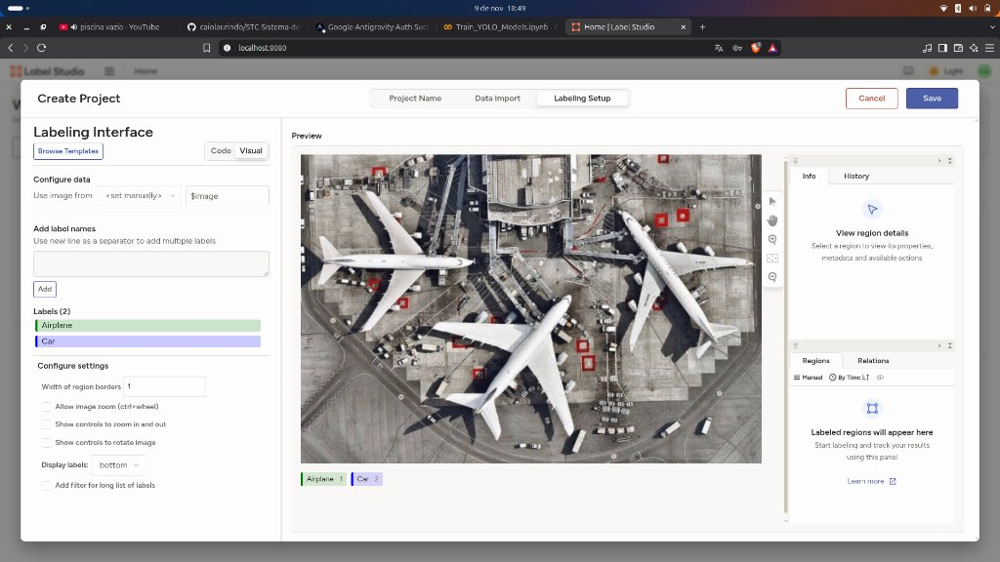
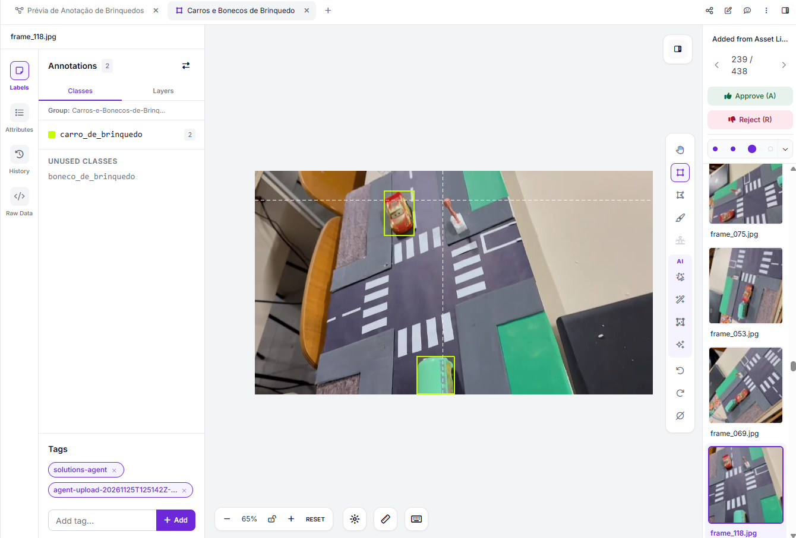
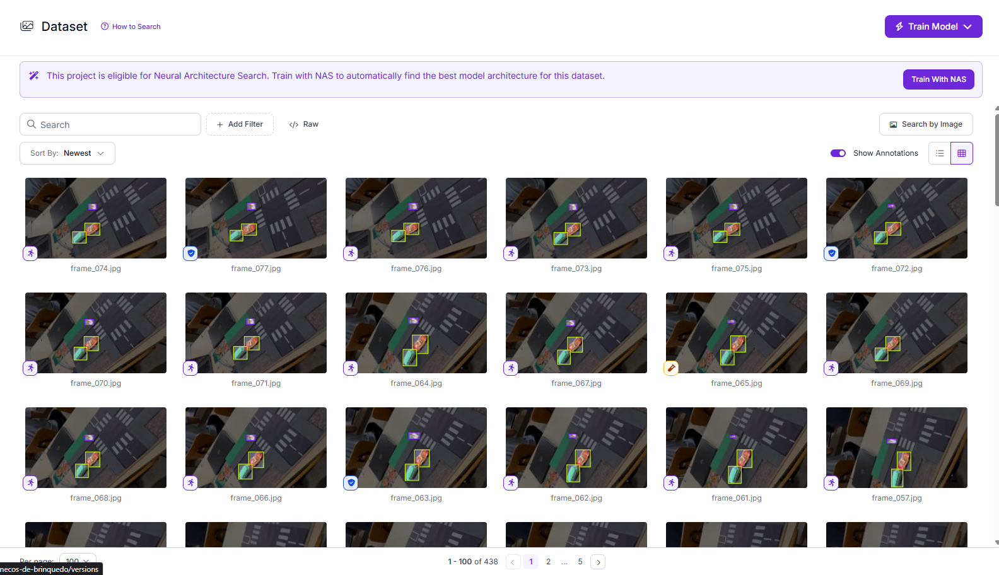
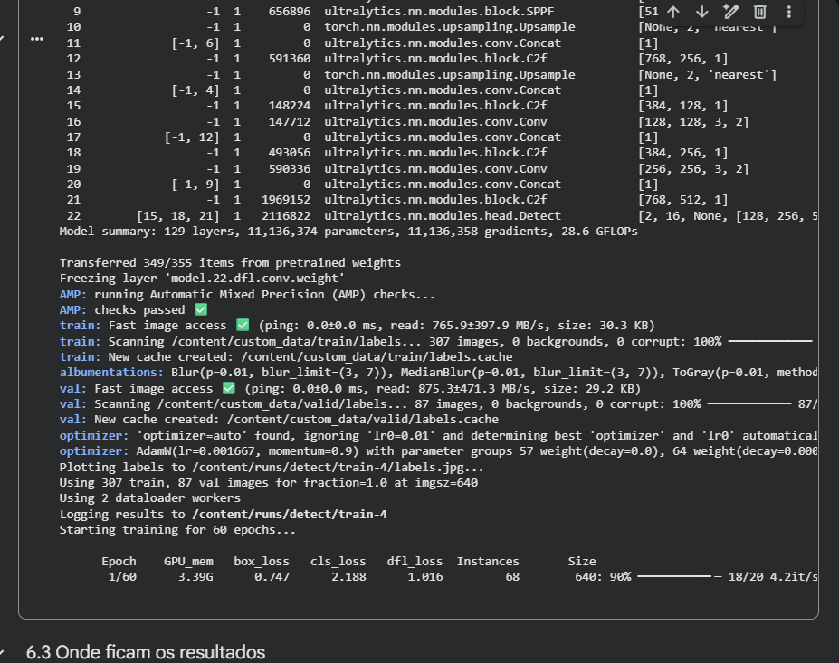
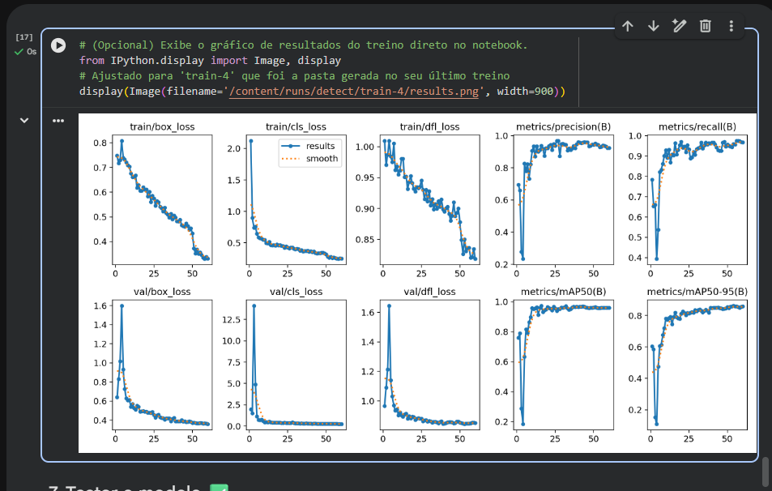
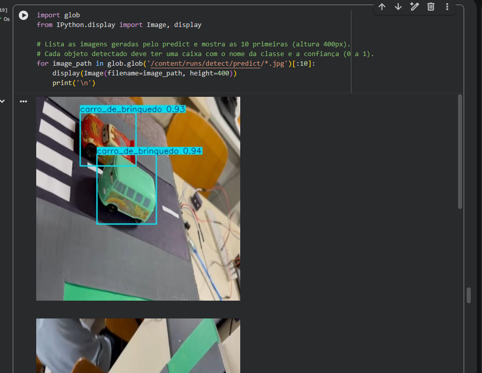
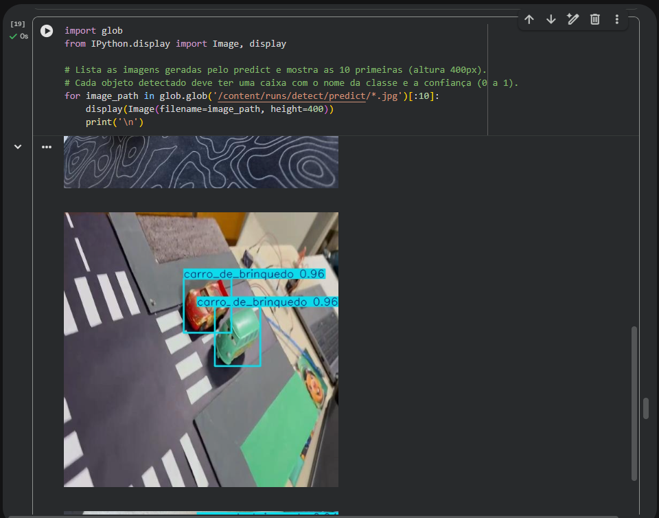
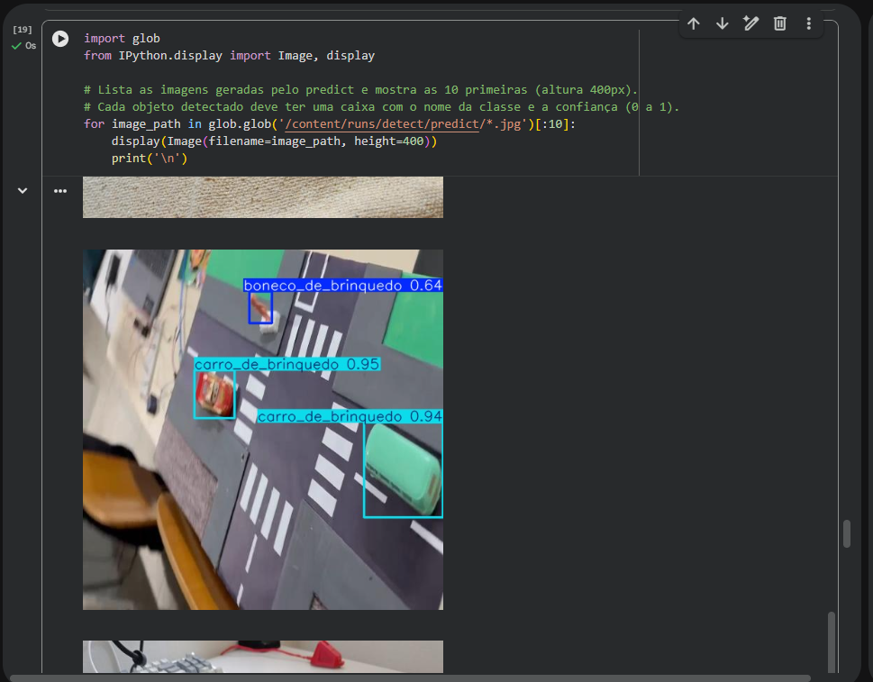

# Tutorial completo: treinando o YOLOv8 para o STC (Sistema de Controle de Tráfego)

Guia de ponta a ponta para treinar e usar um modelo **YOLOv8** de detecção de objetos. Baseado no guia de Evan Juras ([GitHub](https://github.com/EdjeElectronics/Train-and-Deploy-YOLO-Models) e [vídeo](https://youtu.be/r0RspiLG260)).

O processo tem **4 grandes etapas**, e só a terceira acontece no Colab:

| Etapa | Onde | O que se faz |
|-------|------|--------------|
| **A. Preparar o PC** | seu PC | instalar Anaconda, criar ambiente e (opcional) instalar o Label Studio |
| **B. Coletar e rotular imagens** | seu PC / navegador | tirar fotos, marcar os objetos no **Roboflow** (usado neste projeto) ou no Label Studio, exportar |
| **C. Treinar** | Google Colab | enviar o dataset, dividir, treinar, testar, baixar o modelo |
| **D. Usar o modelo** | seu PC | rodar o modelo treinado na webcam, em fotos ou vídeos |

> 📓 A **Etapa C** está pronta em [`Train_YOLOv8_STC.ipynb`](Train_YOLOv8_STC.ipynb). Suba-o no [Google Colab](https://colab.research.google.com) (Arquivo → Fazer upload de notebook).

## Índice

- [A. Preparar o PC](#a-preparar-o-pc)
- [B. Coletar e rotular imagens](#b-coletar-e-rotular-imagens)
- [C. Treinar no Google Colab](#c-treinar-no-google-colab)
- [D. Usar o modelo no PC](#d-usar-o-modelo-no-pc)
- [Erros comuns](#erros-comuns)
- [Arquivos do projeto](#arquivos-do-projeto)

---

# A. Preparar o PC

Você usará o PC para rotular as imagens (Label Studio) e, no fim, para rodar o modelo. Para não misturar bibliotecas com outros projetos, usa-se um **ambiente virtual** do Anaconda.

### A.1 Instalar o Anaconda

1. Acesse [anaconda.com/download](https://anaconda.com/download), clique em **skip registration** e baixe o instalador do seu sistema.
2. Execute o instalador com as opções padrão.
3. Abra o terminal: no Windows, o **Anaconda Prompt** (menu Iniciar); no Linux/macOS, um terminal comum.

### A.2 Criar e ativar o ambiente

```bash
conda create --name YOLO_env python=3.12 -y
conda activate YOLO_env
```

- `conda create --name YOLO_env python=3.12` cria um ambiente isolado chamado `YOLO_env` com Python 3.12 (`-y` aceita as confirmações).
- `conda activate YOLO_env` ativa o ambiente. **Sempre ative antes de usar o Label Studio ou rodar o modelo**: o nome `(YOLO_env)` aparece no início da linha do terminal.

### A.3 Instalar o Label Studio

```bash
pip install label-studio
```

Instala a ferramenta (gratuita, com interface web) usada para desenhar as caixas sobre os objetos.

---

# B. Coletar e rotular imagens

## B.1 Tirar as fotos

O modelo aprende com exemplos, então a qualidade das fotos define a qualidade do resultado.

- Ponto de partida para prova de conceito: **~200 imagens** (mais é melhor).
- Fotografe **o que você quer detectar**. No STC: veículos, **com a câmera/ângulo que será usada em produção**.
- Varie **fundo, iluminação** (dia, noite, chuva), distância, ângulo e quantidade de objetos.
- Inclua imagens com outros objetos além dos de interesse, para o modelo aprender o que *não* é a classe.
- Evite fotos desfocadas. Se usar vídeo, extraia frames espaçados (frames seguidos são quase idênticos e não ajudam).
- Junte tudo em uma pasta no PC.

Alternativa: datasets prontos no [Roboflow Universe](https://universe.roboflow.com) ou [Kaggle](https://www.kaggle.com/datasets), mantendo a mesma estrutura de pastas descrita em [B.7](#b7-exportar-no-formato-yolo).

> 🏷️ **Rotulagem usada neste projeto: Roboflow.** O modelo atual foi treinado com **438 imagens** (frames de vídeo da maquete) rotuladas no [Roboflow](https://roboflow.com) (classes `boneco_de_brinquedo` e `carro_de_brinquedo`). Começamos com o Label Studio, mas no Roboflow a marcação foi mais rápida. Veja [B.8](#b8-alternativa-usada-no-projeto-roboflow). Os passos B.2 a B.7 mostram o Label Studio, que roda no PC e não depende de conta online.

## B.2 Iniciar o Label Studio

Com o ambiente ativo (`conda activate YOLO_env`):

```bash
label-studio start
```

Isso inicia o servidor local e abre o navegador em `http://localhost:8080` (se não abrir, acesse manualmente). Na primeira vez, crie uma conta local (e-mail e senha). **Deixe o terminal aberto** enquanto rotula; fechá-lo derruba o servidor.

## B.3 Criar um novo projeto

Na tela inicial (**Home**), clique em **Create Project**. Na aba **Project Name**, dê um nome (ex.: `STC-Veiculos`). Projetos já criados aparecem em *Recent Projects*.


## B.4 Fazer upload das imagens

Vá na aba **Data Import** e arraste as imagens para a área indicada ou clique em **Upload Files**.


Depois do envio, os arquivos são listados e o canto superior direito mostra "N files uploaded". Para adicionar mais, use **Upload More Files**.


## B.5 Escolher o tipo de rotulagem e criar as labels

Na aba **Labeling Setup**, escolha o template de rotulagem. Para o YOLO (detecção) use **Object Detection with Bounding Boxes** (*Browse Templates* → *Computer Vision*). Depois:

1. Remova as labels de exemplo do template.
2. Em **Add label names**, digite uma classe por linha (ex.: `carro`, `moto`, `onibus`, `caminhao`) e clique em **Add**.
3. As classes aparecem em *Labels*, cada uma com uma cor; o **Preview** mostra como ficará a interface.
4. Clique em **Save**.

> ⚠️ **Ordem e grafia importam**: a ordem define o id da classe (a primeira é `0`, a segunda `1`...) e os nomes viram o `classes.txt`. Evite acentos e espaços.



*(O exemplo da imagem usa `Airplane` e `Car`; no STC use as suas classes.)*

## B.6 Marcar os objetos

1. Abra o projeto e clique em **Label All Tasks** (ou em uma imagem da lista).
2. Selecione a label (clicando nela ou usando o atalho numérico, ex.: `1`).
3. Clique e arraste sobre o objeto para desenhar uma caixa justa ao redor dele.
4. Marque **todos** os objetos de interesse da imagem, inclusive os pequenos ou parcialmente cobertos.
5. Clique em **Submit** e vá para a próxima. Repita até terminar todas.

Dicas: use zoom (Ctrl + roda do mouse) em objetos pequenos; mantenha o mesmo critério em todas as imagens; imagens sem objetos também valem (submeta sem caixas).

## B.7 Exportar no formato YOLO

No projeto, clique em **Export** e escolha o formato **YOLO**. Será baixado um `project.zip` contendo:

| Item | Descrição |
|------|-----------|
| `images/` | as imagens |
| `labels/` | um `.txt` por imagem; cada linha é um objeto: `id_classe x_centro y_centro largura altura` (valores de 0 a 1) |
| `classes.txt` | nomes das classes, uma por linha |
| `notes.json` | específico do Label Studio (ignorar) |

Estrutura final esperada (renomeie o zip para **`data.zip`**):

```
data.zip
├── images/
├── labels/
└── classes.txt
```

Um exemplo de `classes.txt` está em [`classes.txt`](classes.txt). Se o dataset vier de outra fonte, organize os arquivos do mesmo jeito.

## B.8 Alternativa usada no projeto: Roboflow

O [Roboflow](https://roboflow.com) faz a rotulagem no navegador e foi a ferramenta usada nas **438 imagens** deste projeto, por ser mais rápido que o Label Studio.

1. Crie uma conta gratuita e um projeto do tipo **Object Detection**.
2. Envie as imagens em **Upload**.
3. Em **Annotate**, desenhe as caixas e dê um nome a cada classe (sem acentos nem espaços, ex.: `carro_de_brinquedo`). As mesmas dicas de B.6 valem aqui.
4. Gere uma versão do dataset (**Generate**) e exporte em **Export Dataset → formato YOLOv8 → download zip**.

**Tela de anotação.** Mostra a imagem `frame_118.jpg` (a 239ª de 438) sendo rotulada. As fotos são frames extraídos de um vídeo da **maquete do STC**: um cruzamento em miniatura com faixas de pedestre, um carrinho vermelho e uma van verde. As duas caixas amarelas são os objetos marcados como `carro_de_brinquedo`. No painel da esquerda, o contador "Annotations 2" confirma as duas marcações, e `boneco_de_brinquedo` aparece em *Unused classes* porque o boneco não foi marcado nesta imagem. À direita ficam os outros frames do dataset e os botões **Approve/Reject** para revisar cada anotação. A barra de ferramentas tem a caixa (*bounding box*) e os recursos de IA do Roboflow, que sugerem caixas automaticamente e foram o que deixou a rotulagem mais rápida.



**Visão geral do dataset.** É a aba **Dataset** com as 438 imagens (100 por página) e a opção *Show Annotations* ligada, que desenha as caixas sobre as miniaturas. Os nomes em sequência (`frame_057` a `frame_077`) mostram que vêm do mesmo vídeo. Os ícones no canto de cada miniatura indicam o estado da anotação: aprovada, feita com ajuda da IA ou editada à mão. Pela galeria dá para conferir rapidamente se todas as imagens foram marcadas e se as caixas estão justas.



O zip do Roboflow tem outra estrutura: as pastas `train/`, `valid/` e `test/` (cada uma com `images/` e `labels/`) e um `data.yaml` com os nomes das classes. Ele **já vem dividido** em treino e validação, então neste projeto o passo `train_val_split.py` de C.3 foi pulado:

1. Descompacte direto em `/content/custom_data` (`!unzip -q /content/data.zip -d /content/custom_data`).
2. Crie o `data.yaml` apontando para as pastas do Roboflow, com as classes na mesma ordem do `data.yaml` exportado:

```yaml
path: /content/custom_data
train: train/images
val: valid/images
nc: 2
names: ['boneco_de_brinquedo', 'carro_de_brinquedo']
```

Neste treino, o YOLO encontrou **307 imagens de treino e 87 de validação** (veja o log em C.6). As demais ficaram na pasta `test/` do Roboflow.

---

# C. Treinar no Google Colab

O Colab fornece uma VM Linux no navegador com **GPU gratuita** (Tesla T4). Abra o [`Train_YOLOv8_STC.ipynb`](Train_YOLOv8_STC.ipynb) e execute os blocos em ordem. Os comandos abaixo são os mesmos do notebook (que traz mais comentários).

## C.1 Ativar e verificar a GPU

Menu **Ambiente de execução → Alterar tipo de ambiente de execução → GPU → Salvar**. Verifique:

```python
!nvidia-smi
```

Se aparecer uma tabela com a placa (ex.: Tesla T4), está pronto. Sem GPU, o treino demora muito mais.

## C.2 Enviar o dataset

O Colab roda na nuvem e não vê os arquivos do seu PC. Escolha uma opção:

**Opção 1 – Upload direto:** ícone de pasta 📁 → "Fazer upload para o armazenamento da sessão" → `data.zip`.

**Opção 2 – Google Drive** (recomendado se >50MB; não precisa reenviar a cada sessão). Suba o `data.zip` ao Drive e ajuste o caminho:

```python
from google.colab import drive
drive.mount('/content/gdrive')
!cp /content/gdrive/MyDrive/caminho/para/data.zip /content
```

**Opção 3 – Dataset de exemplo** (só para testar o fluxo):

```python
!wget -O /content/data.zip https://s3.us-west-1.amazonaws.com/evanjuras.com/resources/candy_data_06JAN25.zip
```

> ⚠️ Os arquivos em `/content` são apagados quando a sessão termina. Baixe o modelo ao final (C.8).

## C.3 Descompactar e dividir em treino/validação

```python
!unzip -q /content/data.zip -d /content/custom_data
```

O Ultralytics exige `data/{train,validation}/{images,labels}`:
- **train** (90%): imagens que a rede usa para aprender.
- **validation** (10%): imagens que ela nunca usa para aprender, só para medir se está generalizando ou apenas "decorando" o treino.

O script abaixo cria a estrutura e sorteia as imagens:

```python
!wget -O /content/train_val_split.py https://raw.githubusercontent.com/EdjeElectronics/Train-and-Deploy-YOLO-Models/refs/heads/main/utils/train_val_split.py
!python train_val_split.py --datapath="/content/custom_data" --train_pct=0.9
```

## C.4 Instalar o Ultralytics

```python
!pip install ultralytics
```

Instala o YOLOv8 e o comando `yolo` (junto vêm PyTorch, OpenCV e NumPy).

## C.5 Gerar o `data.yaml`

Informa ao treino onde estão as imagens e quais são as classes (`path`, `train`, `val`, `nc`, `names`). O código lê o `classes.txt` e gera o arquivo:

```python
import yaml, os

def create_data_yaml(path_to_classes_txt, path_to_data_yaml):
    if not os.path.exists(path_to_classes_txt):
        print(f'classes.txt não encontrado! Crie o arquivo em {path_to_classes_txt}')
        return
    with open(path_to_classes_txt, 'r') as f:
        classes = [l.strip() for l in f.readlines() if len(l.strip()) > 0]

    data = {
        'path': '/content/data',
        'train': 'train/images',
        'val': 'validation/images',
        'nc': len(classes),
        'names': classes
    }
    with open(path_to_data_yaml, 'w') as f:
        yaml.dump(data, f, sort_keys=False)
    print(f'Arquivo criado em {path_to_data_yaml}')

create_data_yaml('/content/custom_data/classes.txt', '/content/data.yaml')
!cat /content/data.yaml
```

## C.6 Treinar

| Parâmetro | Descrição | Sugestão |
|-----------|-----------|----------|
| `model` | `yolov8n.pt` (mais rápido), `yolov8s.pt`, `yolov8m.pt`, `yolov8l.pt`, `yolov8x.pt` (mais preciso) | `yolov8s.pt` |
| `epochs` | passadas completas pelo dataset | ~60 se <200 imagens; ~40 se >200 |
| `imgsz` | resolução | 640 (480 para mais velocidade) |

Qual modelo escolher:

| Modelo | Velocidade | Precisão | Quando usar |
|--------|-----------|----------|-------------|
| `yolov8n.pt` (nano) | ⚡⚡⚡ | + | CPU fraca, Raspberry Pi |
| `yolov8s.pt` (small) | ⚡⚡ | ++ | bom ponto de partida, **usado neste projeto** |
| `yolov8m.pt` (medium) | ⚡ | +++ | PC com GPU |
| `yolov8l.pt` / `yolov8x.pt` | 🐢 | ++++ | máxima precisão, exige GPU forte |

> 🔄 **Mudança de modelo:** a primeira versão do STC foi treinada com `yolov8m.pt` (medium). Ele é mais preciso, mas lento sem GPU. O modelo atual usa `yolov8s.pt` (small), que roda bem mais rápido na CPU e manteve boa precisão (mAP50 ≈ 0,97 na validação).

```python
!yolo detect train data=/content/data.yaml model=yolov8s.pt epochs=60 imgsz=640
```

A cada época o programa valida e informa **precisão, recall e mAP**; o mAP deve subir ao longo do treino.

> ⚠️ Deixe o treino **terminar**: ao final um otimizador remove camadas desnecessárias do modelo.

Resultados em `/content/runs/detect/train/`: `weights/best.pt` (melhor modelo), `weights/last.pt`, `results.png` (curvas de loss/precisão/recall/mAP) e `confusion_matrix.png`. Se você treinar mais de uma vez na mesma sessão, as pastas seguintes se chamam `train-2`, `train-3`... O modelo deste repositório saiu de `train-4`.

**Início do treino no Colab.** O topo da tela mostra o fim do resumo da arquitetura: as camadas finais do YOLOv8s e a camada `Detect`, já ajustada para **2 classes**. A linha *Model summary* informa **129 camadas, 11,1 milhões de parâmetros e 28,6 GFLOPs** (o custo de processar uma imagem). Em seguida, o log mostra que:

- os pesos pré-treinados foram aproveitados (*Transferred 349/355 items*), então a rede não começa do zero;
- o teste de precisão mista (**AMP**) passou, o que deixa o treino na GPU mais rápido;
- o YOLO leu **307 imagens de treino** e **87 de validação**, sem nenhuma corrompida (*0 corrupt*);
- o otimizador foi escolhido automaticamente (**AdamW**, lr = 0,001667);
- os resultados vão para `/content/runs/detect/train-4`, e o treino começa a contar as **60 épocas**. A última linha mostra a época 1 em andamento, com 3,39 GB de memória da GPU e as perdas (`box_loss`, `cls_loss`, `dfl_loss`).



**Curvas do treino (`results.png`).** Cada gráfico mostra uma métrica ao longo das 60 épocas (eixo horizontal). Os pontos azuis são os valores de cada época e a linha laranja tracejada é a média suavizada.

| Gráficos | O que medem | O que aconteceu neste treino |
|----------|-------------|------------------------------|
| `train/box_loss`, `cls_loss`, `dfl_loss` | erro nas imagens de treino: posição da caixa, classe e ajuste fino das bordas | caem de forma contínua, ou seja, o modelo aprendeu |
| `val/box_loss`, `cls_loss`, `dfl_loss` | o mesmo erro nas imagens de validação, que o modelo nunca viu | pico nas primeiras épocas (instabilidade normal do início), depois caem e se estabilizam baixos. Como não voltam a subir, não houve *overfitting* |
| `metrics/precision(B)` | das caixas que o modelo desenhou, quantas estavam certas | ≈ 0,92 no fim |
| `metrics/recall(B)` | dos objetos reais, quantos o modelo encontrou | ≈ 0,97 no fim |
| `metrics/mAP50(B)` | acerto geral, considerando certa a caixa que cobre pelo menos 50% do objeto | ≈ 0,96, estável desde a época 15 |
| `metrics/mAP50-95(B)` | acerto geral, exigindo caixas cada vez mais justas (50% a 95%) | sobe até ≈ 0,86 |

Em resumo: o modelo acerta quase todos os objetos da maquete, com caixas bem posicionadas. Os valores finais exatos estão na última linha de [`my_model/train/results.csv`](my_model/train/results.csv).



## C.7 Testar o modelo

```python
!yolo detect predict model=runs/detect/train/weights/best.pt source=data/validation/images save=True
```

```python
import glob
from IPython.display import Image, display
for p in glob.glob('/content/runs/detect/predict/*.jpg')[:10]:
    display(Image(filename=p, height=400))
```

Cada objeto deve receber uma caixa com o nome da classe e a **confiança** (de 0 a 1: quanto o modelo "tem certeza" da detecção). Abaixo estão três resultados do modelo deste repositório em imagens de validação, que ele não viu no treino:

**Teste 1: dois carros próximos.** Visto de cima, o carrinho vermelho e a van verde estão parcialmente sobrepostos na faixa. Mesmo assim, o modelo separou os dois corretamente: `carro_de_brinquedo` com **0,93** e **0,94**.



**Teste 2: outro ângulo.** Os mesmos carros, agora no cruzamento e com a câmera mais inclinada, e fios e uma placa eletrônica no fundo. As duas detecções saem com **0,96**, então o ângulo diferente e os objetos ao redor não confundiram o modelo.



**Teste 3: as duas classes juntas.** Além dos dois carros (**0,95** e **0,94**), o modelo encontrou o **boneco** no alto da imagem (caixa azul, `boneco_de_brinquedo` com **0,64**). A confiança do boneco é menor porque ele é pequeno na imagem e aparece em menos fotos do dataset do que os carros. Para melhorar, adicione mais imagens com o boneco em posições e distâncias variadas. Na webcam, se o boneco sumir, baixe o `--conf` (D.3).



Se o resultado for ruim: revise erros de rotulagem, aumente as épocas, use um modelo maior (ex.: `yolov8l.pt`) ou adicione mais imagens. Para vídeos, use `source=/content/video.mp4`.

## C.8 Baixar o modelo

```python
!mkdir /content/my_model
!cp /content/runs/detect/train/weights/best.pt /content/my_model/my_model.pt
!cp -r /content/runs/detect/train /content/my_model

%cd my_model
!zip /content/my_model.zip my_model.pt
!zip -r /content/my_model.zip train
%cd /content
```

```python
from google.colab import files
files.download('/content/my_model.zip')  # pode demorar; também dá para baixar pela barra lateral
```

---

# D. Usar o modelo no PC

Este repositório já traz um modelo treinado em [`my_model/my_model.pt`](my_model/my_model.pt) (YOLOv8s, 60 épocas, 438 imagens rotuladas no Roboflow, classes `boneco_de_brinquedo` e `carro_de_brinquedo`) e o script [`testar_camera.py`](testar_camera.py) para testá-lo na webcam. Os resultados do treino (curvas, matriz de confusão, `results.png`) estão em [`my_model/train/`](my_model/train/).

### D.1 Clonar o repositório

```bash
git clone https://github.com/caiolaurindo/STC-Sistema-de-Controle-de-Trafego.git
cd STC-Sistema-de-Controle-de-Trafego
```

Para usar um modelo que **você** treinou, descompacte o `my_model.zip` baixado em C.8 e substitua o arquivo `my_model/my_model.pt`.

### D.2 Instalar as dependências

No terminal com o ambiente `YOLO_env` ativo (criado em A.2):

```bash
pip install -r requirements.txt
```

Instala o Ultralytics, que já traz PyTorch, OpenCV e NumPy.

*(Opcional, só com GPU NVIDIA)* instale **antes** o PyTorch com suporte a CUDA, que deixa a detecção muito mais rápida:

```bash
pip install --upgrade torch torchvision torchaudio --index-url https://download.pytorch.org/whl/cu124
```

### D.3 Testar com a webcam

```bash
python testar_camera.py
```

Abre uma janela com a câmera ao vivo, as caixas das detecções e um painel com o FPS do vídeo, o FPS do modelo e a contagem por classe. A primeira detecção demora alguns segundos (aquecimento do modelo).

| Tecla | Ação |
|-------|------|
| `q` ou `ESC` | sair |
| `s` | salvar um print em `capturas/` |

Opções úteis:

| Opção | Padrão | Para que serve |
|-------|--------|----------------|
| `--camera` | `0` | índice da câmera; tente `1` se a webcam não abrir |
| `--conf` | `0.25` | confiança mínima; suba (ex.: `0.5`) se aparecerem detecções falsas |
| `--imgsz` | `416` | tamanho da imagem na inferência; menor = mais rápido, menos preciso |
| `--modelo` | `my_model/my_model.pt` | outro arquivo de pesos |

Exemplo: `python testar_camera.py --camera 1 --conf 0.4`

> ⚡ **Desempenho:** a detecção roda numa thread separada, então o vídeo fica fluido mesmo que as caixas atualizem devagar. Por isso o modelo atual usa `yolov8s.pt`: os modelos maiores (`m`, `l`) ficam lentos sem GPU NVIDIA. Se ainda estiver lento na sua máquina, use `--imgsz 320` ou treine com `yolov8n.pt` (C.6). Exportar para ONNX/OpenVINO quase não ajudou nos nossos testes.

### D.4 Testar em fotos ou vídeos

Sem câmera, rode o modelo direto em arquivos:

```bash
yolo detect predict model=my_model/my_model.pt source=caminho/da/pasta conf=0.25 save=True
```

As imagens com as caixas ficam em `runs/detect/predict/`. Use fotos que **não** estavam no treino, senão o resultado parece melhor do que é.

### D.5 Raspberry Pi e outros dispositivos

O modelo pode ser exportado para ONNX ou TFLite (`yolo export model=my_model/my_model.pt format=onnx`), útil para dispositivos de borda. Veja a seção 8.1 do notebook.

---

# Erros comuns

- **Pasta/arquivo não encontrado:** confira a estrutura do dataset (`images/`, `labels/`, `classes.txt`).
- **Erro no `data.yaml`:** confira typos e linhas em branco no `classes.txt`.
- **`nvidia-smi` falha no Colab:** a GPU não está ativada (C.1).
- **Arquivos sumiram no Colab:** a sessão expirou; use o Drive e baixe o modelo ao final.
- **`label-studio` ou `yolo` não encontrados no PC:** o ambiente não está ativo; rode `conda activate YOLO_env`.
- **Webcam não abre:** tente outro índice com `python testar_camera.py --camera 1` e feche outros programas que usam a câmera.
- **Poucas ou nenhuma detecção:** baixe o `--conf` (ex.: `0.15`) e confira se os objetos parecem com os do treino.
- Persistindo, pesquise o erro ou abra uma [Issue no GitHub](https://github.com/EdjeElectronics/Train-and-Deploy-YOLO-Models/issues).

# Arquivos do projeto

| Arquivo | O que é |
|---------|---------|
| [`Train_YOLOv8_STC.ipynb`](Train_YOLOv8_STC.ipynb) | notebook do Colab com a Etapa C |
| [`my_model/my_model.pt`](my_model/my_model.pt) | modelo treinado (classes `boneco_de_brinquedo` e `carro_de_brinquedo`) |
| [`my_model/train/`](my_model/train/) | métricas e gráficos do treino |
| [`testar_camera.py`](testar_camera.py) | testa o modelo na webcam (D.3) |
| [`requirements.txt`](requirements.txt) | dependências para rodar o modelo |

Próximo passo: integrar o modelo ao STC (contagem de veículos, registro ao longo do tempo, captura de imagens em eventos).
