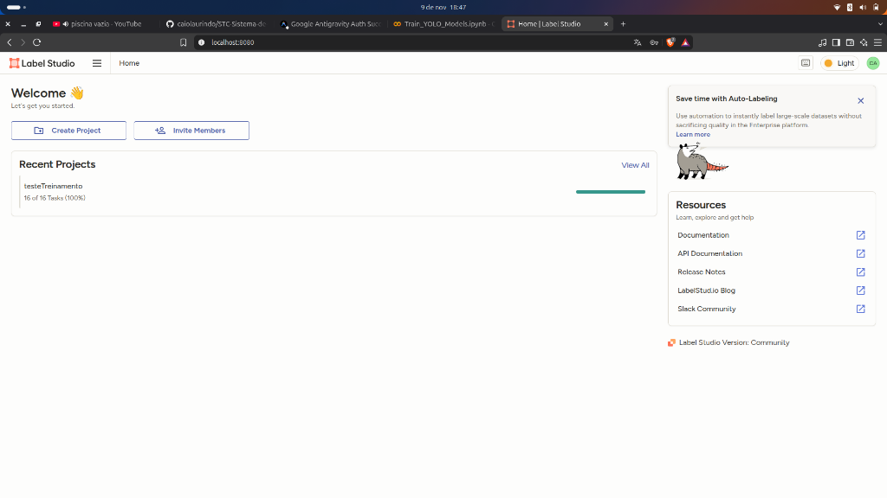
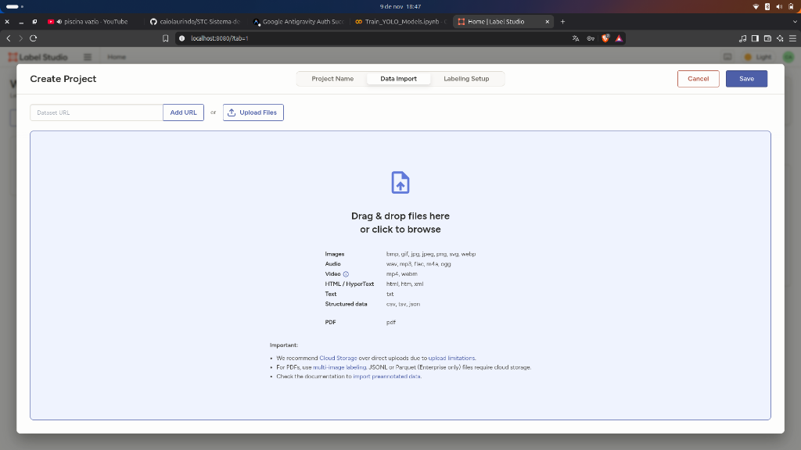
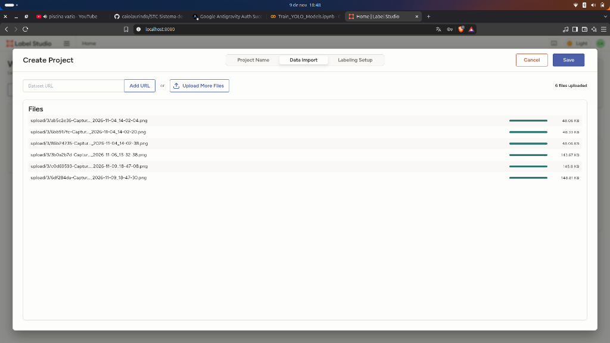
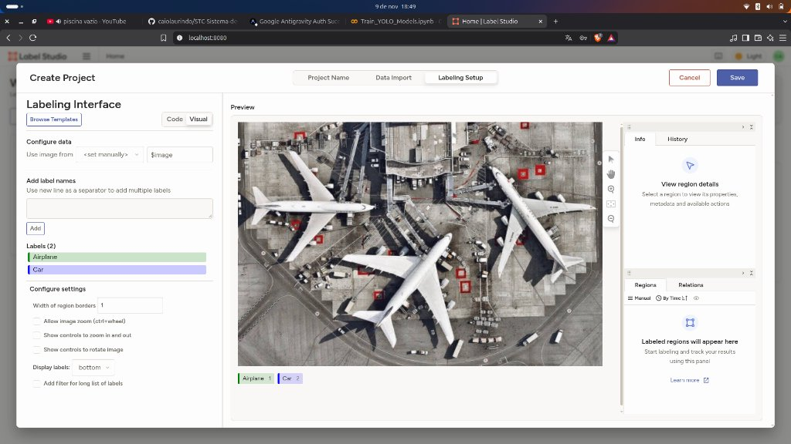

# Tutorial completo: treinando o YOLOv8 para o STC (Sistema de Controle de Tráfego)

Guia de ponta a ponta para treinar e usar um modelo **YOLOv8** de detecção de objetos. Baseado no guia de Evan Juras ([GitHub](https://github.com/EdjeElectronics/Train-and-Deploy-YOLO-Models) e [vídeo](https://youtu.be/r0RspiLG260)).

O processo tem **4 grandes etapas**, e só a terceira acontece no Colab:

| Etapa | Onde | O que se faz |
|-------|------|--------------|
| **A. Preparar o PC** | seu PC | instalar Anaconda, criar ambiente e instalar o Label Studio |
| **B. Coletar e rotular imagens** | seu PC | tirar fotos, criar o projeto no Label Studio, marcar objetos, exportar |
| **C. Treinar** | Google Colab | enviar o dataset, dividir, treinar, testar, baixar o modelo |
| **D. Usar o modelo** | seu PC | rodar o modelo treinado na webcam, vídeo ou imagens |

> 📓 A **Etapa C** está pronta em [`Train_YOLOv8_STC.ipynb`](Train_YOLOv8_STC.ipynb). Suba-o no [Google Colab](https://colab.research.google.com) (Arquivo → Fazer upload de notebook).

## Índice

- [A. Preparar o PC](#a-preparar-o-pc)
- [B. Coletar e rotular imagens](#b-coletar-e-rotular-imagens)
- [C. Treinar no Google Colab](#c-treinar-no-google-colab)
- [D. Usar o modelo no PC](#d-usar-o-modelo-no-pc)
- [Erros comuns](#erros-comuns)
- [Arquivos extras do projeto](#arquivos-extras-do-projeto)

---

# A. Preparar o PC

Você usará o PC para rotular as imagens (Label Studio) e, no fim, para rodar o modelo. Para não misturar bibliotecas com outros projetos, usa-se um **ambiente virtual** do Anaconda.

### A.1 Instalar o Anaconda

1. Acesse [anaconda.com/download](https://anaconda.com/download), clique em **skip registration** e baixe o instalador do seu sistema.
2. Execute o instalador com as opções padrão.
3. Abra o terminal: no Windows, o **Anaconda Prompt** (menu Iniciar); no Linux/macOS, um terminal comum.

### A.2 Criar e ativar o ambiente

```bash
conda create --name YOLO_env python=3.12 -y
conda activate YOLO_env
```

- `conda create --name YOLO_env python=3.12` cria um ambiente isolado chamado `YOLO_env` com Python 3.12 (`-y` aceita as confirmações).
- `conda activate YOLO_env` ativa o ambiente. **Sempre ative antes de usar o Label Studio ou rodar o modelo**: o nome `(YOLO_env)` aparece no início da linha do terminal.

### A.3 Instalar o Label Studio

```bash
pip install label-studio
```

Instala a ferramenta (gratuita, com interface web) usada para desenhar as caixas sobre os objetos.

---

# B. Coletar e rotular imagens

## B.1 Tirar as fotos

O modelo aprende com exemplos, então a qualidade das fotos define a qualidade do resultado.

- Ponto de partida para prova de conceito: **~200 imagens** (mais é melhor).
- Fotografe **o que você quer detectar**. No STC: veículos, **com a câmera/ângulo que será usada em produção**.
- Varie **fundo, iluminação** (dia, noite, chuva), distância, ângulo e quantidade de objetos.
- Inclua imagens com outros objetos além dos de interesse, para o modelo aprender o que *não* é a classe.
- Evite fotos desfocadas. Se usar vídeo, extraia frames espaçados (frames seguidos são quase idênticos e não ajudam).
- Junte tudo em uma pasta no PC.

Alternativa: datasets prontos no [Roboflow Universe](https://universe.roboflow.com) ou [Kaggle](https://www.kaggle.com/datasets), mantendo a mesma estrutura de pastas descrita em [B.7](#b7-exportar-no-formato-yolo).

## B.2 Iniciar o Label Studio

Com o ambiente ativo (`conda activate YOLO_env`):

```bash
label-studio start
```

Isso inicia o servidor local e abre o navegador em `http://localhost:8080` (se não abrir, acesse manualmente). Na primeira vez, crie uma conta local (e-mail e senha). **Deixe o terminal aberto** enquanto rotula; fechá-lo derruba o servidor.

## B.3 Criar um novo projeto

Na tela inicial (**Home**), clique em **Create Project**. Na aba **Project Name**, dê um nome (ex.: `STC-Veiculos`). Projetos já criados aparecem em *Recent Projects*.



## B.4 Fazer upload das imagens

Vá na aba **Data Import** e arraste as imagens para a área indicada ou clique em **Upload Files**.



Depois do envio, os arquivos são listados e o canto superior direito mostra "N files uploaded". Para adicionar mais, use **Upload More Files**.



## B.5 Escolher o tipo de rotulagem e criar as labels

Na aba **Labeling Setup**, escolha o template de rotulagem. Para o YOLO (detecção) use **Object Detection with Bounding Boxes** (*Browse Templates* → *Computer Vision*). Depois:

1. Remova as labels de exemplo do template.
2. Em **Add label names**, digite uma classe por linha (ex.: `carro`, `moto`, `onibus`, `caminhao`) e clique em **Add**.
3. As classes aparecem em *Labels*, cada uma com uma cor; o **Preview** mostra como ficará a interface.
4. Clique em **Save**.

> ⚠️ **Ordem e grafia importam**: a ordem define o id da classe (a primeira é `0`, a segunda `1`...) e os nomes viram o `classes.txt`. Evite acentos e espaços.



*(O exemplo da imagem usa `Airplane` e `Car`; no STC use as suas classes.)*

## B.6 Marcar os objetos

1. Abra o projeto e clique em **Label All Tasks** (ou em uma imagem da lista).
2. Selecione a label (clicando nela ou usando o atalho numérico, ex.: `1`).
3. Clique e arraste sobre o objeto para desenhar uma caixa justa ao redor dele.
4. Marque **todos** os objetos de interesse da imagem, inclusive os pequenos ou parcialmente cobertos.
5. Clique em **Submit** e vá para a próxima. Repita até terminar todas.

Dicas: use zoom (Ctrl + roda do mouse) em objetos pequenos; mantenha o mesmo critério em todas as imagens; imagens sem objetos também valem (submeta sem caixas).

## B.7 Exportar no formato YOLO

No projeto, clique em **Export** e escolha o formato **YOLO**. Será baixado um `project.zip` contendo:

| Item | Descrição |
|------|-----------|
| `images/` | as imagens |
| `labels/` | um `.txt` por imagem; cada linha é um objeto: `id_classe x_centro y_centro largura altura` (valores de 0 a 1) |
| `classes.txt` | nomes das classes, uma por linha |
| `notes.json` | específico do Label Studio (ignorar) |

Estrutura final esperada (renomeie o zip para **`data.zip`**):

```
data.zip
├── images/
├── labels/
└── classes.txt
```

Um exemplo de `classes.txt` está em [`classes.txt`](classes.txt). Se o dataset vier de outra fonte, organize os arquivos do mesmo jeito.

---

# C. Treinar no Google Colab

O Colab fornece uma VM Linux no navegador com **GPU gratuita** (Tesla T4). Abra o [`Train_YOLOv8_STC.ipynb`](Train_YOLOv8_STC.ipynb) e execute os blocos em ordem. Os comandos abaixo são os mesmos do notebook (que traz mais comentários).

## C.1 Ativar e verificar a GPU

Menu **Ambiente de execução → Alterar tipo de ambiente de execução → GPU → Salvar**. Verifique:

```python
!nvidia-smi
```

Se aparecer uma tabela com a placa (ex.: Tesla T4), está pronto. Sem GPU, o treino demora muito mais.

## C.2 Enviar o dataset

O Colab roda na nuvem e não vê os arquivos do seu PC. Escolha uma opção:

**Opção 1 – Upload direto:** ícone de pasta 📁 → "Fazer upload para o armazenamento da sessão" → `data.zip`.

**Opção 2 – Google Drive** (recomendado se >50MB; não precisa reenviar a cada sessão). Suba o `data.zip` ao Drive e ajuste o caminho:

```python
from google.colab import drive
drive.mount('/content/gdrive')
!cp /content/gdrive/MyDrive/caminho/para/data.zip /content
```

**Opção 3 – Dataset de exemplo** (só para testar o fluxo):

```python
!wget -O /content/data.zip https://s3.us-west-1.amazonaws.com/evanjuras.com/resources/candy_data_06JAN25.zip
```

> ⚠️ Os arquivos em `/content` são apagados quando a sessão termina. Baixe o modelo ao final (C.8).

## C.3 Descompactar e dividir em treino/validação

```python
!unzip -q /content/data.zip -d /content/custom_data
```

O Ultralytics exige `data/{train,validation}/{images,labels}`:
- **train** (90%): imagens que a rede usa para aprender.
- **validation** (10%): imagens que ela nunca usa para aprender, só para medir se está generalizando ou apenas "decorando" o treino.

O script abaixo cria a estrutura e sorteia as imagens:

```python
!wget -O /content/train_val_split.py https://raw.githubusercontent.com/EdjeElectronics/Train-and-Deploy-YOLO-Models/refs/heads/main/utils/train_val_split.py
!python train_val_split.py --datapath="/content/custom_data" --train_pct=0.9
```

## C.4 Instalar o Ultralytics

```python
!pip install ultralytics
```

Instala o YOLOv8 e o comando `yolo` (junto vêm PyTorch, OpenCV e NumPy).

## C.5 Gerar o `data.yaml`

Informa ao treino onde estão as imagens e quais são as classes (`path`, `train`, `val`, `nc`, `names`). O código lê o `classes.txt` e gera o arquivo:

```python
import yaml, os

def create_data_yaml(path_to_classes_txt, path_to_data_yaml):
    if not os.path.exists(path_to_classes_txt):
        print(f'classes.txt não encontrado! Crie o arquivo em {path_to_classes_txt}')
        return
    with open(path_to_classes_txt, 'r') as f:
        classes = [l.strip() for l in f.readlines() if len(l.strip()) > 0]

    data = {
        'path': '/content/data',
        'train': 'train/images',
        'val': 'validation/images',
        'nc': len(classes),
        'names': classes
    }
    with open(path_to_data_yaml, 'w') as f:
        yaml.dump(data, f, sort_keys=False)
    print(f'Arquivo criado em {path_to_data_yaml}')

create_data_yaml('/content/custom_data/classes.txt', '/content/data.yaml')
!cat /content/data.yaml
```

## C.6 Treinar

| Parâmetro | Descrição | Sugestão |
|-----------|-----------|----------|
| `model` | `yolov8n.pt` (mais rápido), `yolov8s.pt`, `yolov8m.pt`, `yolov8l.pt`, `yolov8x.pt` (mais preciso) | `yolov8s.pt` |
| `epochs` | passadas completas pelo dataset | ~60 se <200 imagens; ~40 se >200 |
| `imgsz` | resolução | 640 (480 para mais velocidade) |

```python
!yolo detect train data=/content/data.yaml model=yolov8s.pt epochs=60 imgsz=640
```

A cada época o programa valida e informa **precisão, recall e mAP**; o mAP deve subir ao longo do treino.

> ⚠️ Deixe o treino **terminar**: ao final um otimizador remove camadas desnecessárias do modelo.

Resultados em `/content/runs/detect/train/`: `weights/best.pt` (melhor modelo), `weights/last.pt`, `results.png` (curvas de loss/precisão/recall/mAP) e `confusion_matrix.png`.

## C.7 Testar o modelo

```python
!yolo detect predict model=runs/detect/train/weights/best.pt source=data/validation/images save=True
```

```python
import glob
from IPython.display import Image, display
for p in glob.glob('/content/runs/detect/predict/*.jpg')[:10]:
    display(Image(filename=p, height=400))
```

Cada objeto deve receber uma caixa. Se o resultado for ruim: revise erros de rotulagem, aumente as épocas, use um modelo maior (ex.: `yolov8l.pt`) ou adicione mais imagens. Para vídeos, use `source=/content/video.mp4`.

## C.8 Baixar o modelo

```python
!mkdir /content/my_model
!cp /content/runs/detect/train/weights/best.pt /content/my_model/my_model.pt
!cp -r /content/runs/detect/train /content/my_model

%cd my_model
!zip /content/my_model.zip my_model.pt
!zip -r /content/my_model.zip train
%cd /content
```

```python
from google.colab import files
files.download('/content/my_model.zip')  # pode demorar; também dá para baixar pela barra lateral
```

---

# D. Usar o modelo no PC

Volte ao **seu PC**, no terminal com o ambiente `YOLO_env` (criado em A.2).

### D.1 Extrair o modelo

Descompacte o `my_model.zip` baixado e entre na pasta:

```bash
cd caminho/para/my_model
```

### D.2 Instalar o Ultralytics

```bash
pip install ultralytics
```

Instala a biblioteca que carrega e roda modelos YOLO (traz OpenCV, NumPy e PyTorch).

*(Opcional, só com GPU NVIDIA)* instale o PyTorch com suporte a CUDA para acelerar:

```bash
pip install --upgrade torch torchvision torchaudio --index-url https://download.pytorch.org/whl/cu124
```

### D.3 Baixar o script de detecção

```bash
curl -o yolo_detect.py https://raw.githubusercontent.com/EdjeElectronics/Train-and-Deploy-YOLO-Models/refs/heads/main/yolo_detect.py
```

Baixa o script do autor, que carrega o modelo, roda a inferência e desenha as caixas.

### D.4 Executar a detecção

Webcam USB a 1280x720:

```bash
python yolo_detect.py --model my_model.pt --source usb0 --resolution 1280x720
```

Abre uma janela com a imagem da câmera e as caixas desenhadas. O `--source` também aceita vídeo, imagem ou pasta de imagens (ex.: `--source video.mp4`). Veja todas as opções com `python yolo_detect.py --help`.

### D.5 Raspberry Pi e outros dispositivos

O modelo pode ser exportado para ONNX ou TFLite (`yolo export model=my_model.pt format=onnx`), útil para dispositivos de borda. Veja a seção 8.1 do notebook.

---

# Erros comuns

- **Pasta/arquivo não encontrado:** confira a estrutura do dataset (`images/`, `labels/`, `classes.txt`).
- **Erro no `data.yaml`:** confira typos e linhas em branco no `classes.txt`.
- **`nvidia-smi` falha no Colab:** a GPU não está ativada (C.1).
- **Arquivos sumiram no Colab:** a sessão expirou; use o Drive e baixe o modelo ao final.
- **`label-studio` ou `yolo` não encontrados no PC:** o ambiente não está ativo; rode `conda activate YOLO_env`.
- Persistindo, pesquise o erro ou abra uma [Issue no GitHub](https://github.com/EdjeElectronics/Train-and-Deploy-YOLO-Models/issues).

# Arquivos extras do projeto

- [`classes.txt`](classes.txt): exemplo de labelmap do STC (carro, moto, onibus, caminhao).
- [`stc_detect.py`](stc_detect.py): roda o modelo em webcam ou vídeo e mostra a contagem por classe:
  ```bash
  python stc_detect.py --model my_model.pt --source 0
  ```

Próximo passo: integrar o modelo ao STC (contagem de veículos, registro ao longo do tempo, captura de imagens em eventos).
